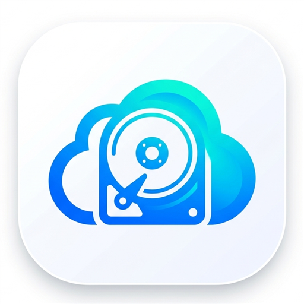

<p align="center">
  
</p>

# VPS3Drive (.NET 8 / C# WPF Edition)

**VPS3Drive** mounts **Amazon S3** and **S3-compatible** object storage (Cloudflare R2, MinIO, Wasabi, Backblaze B2, DigitalOcean Spaces, etc.) as native Windows drive letters via **WinFsp**.

> Looking for the ultra-lightweight **Rust** edition? Switch to the **[`main`](https://github.com/vps3drive/vps3drive/tree/main)** branch.

---

## Highlights
- **Native WPF Desktop UI:** Multi-window Windows desktop experience with Storage Accounts manager, Bucket & Prefix browser, Advanced Drive Properties, Default HTTP Headers, and Options.
- **WinFsp Virtual Filesystem:** Mount buckets or subfolder prefixes as `Network` or `Removable` drives.
- **DPAPI Credential Protection:** Encrypts stored S3 secret keys using Windows DPAPI.
- **Hybrid Disk LRU Cache & Write-Back Queue:** 4 MB chunked local read cache with LRU eviction, sequential range prefetching, background write-back staging, and concurrent multipart uploads with live progress in **Tasks / Transfers**.
- **Windows Explorer Context Menu:** Right-click files/folders on mounted drives to copy Presigned URLs (1h / 24h / 7d), S3 URI, HTTPS URL, Purge Cache, or open **Versions & Trash Recovery**.
- **S3 Versioning & Trash Recovery:** Per-drive `.trash/` soft-delete mode plus a dedicated `VersionsWindow` to restore S3 versions/delete markers or recover/empty `.trash/` items.
- **Auto-Update & Auto-Release:** Built-in GitHub Release update checker (`UpdateService`) and automated Windows Setup + Portable builds via GitHub Actions (`dotnet-v*` tags).

## Requirements
- Windows 10 / 11 (x64)
- [.NET 8 Desktop Runtime (x64)](https://dotnet.microsoft.com/en-us/download/dotnet/8.0)
- WinFsp (bundled inside both the Setup installer and Portable archive)

## Build & Test
```powershell
dotnet restore VPS3Drive.sln
dotnet build VPS3Drive.sln --configuration Release
dotnet test tests/VPS3Drive.Core.Tests/VPS3Drive.Core.Tests.csproj --configuration Release
```

## License
MIT — see [LICENSE](LICENSE).
